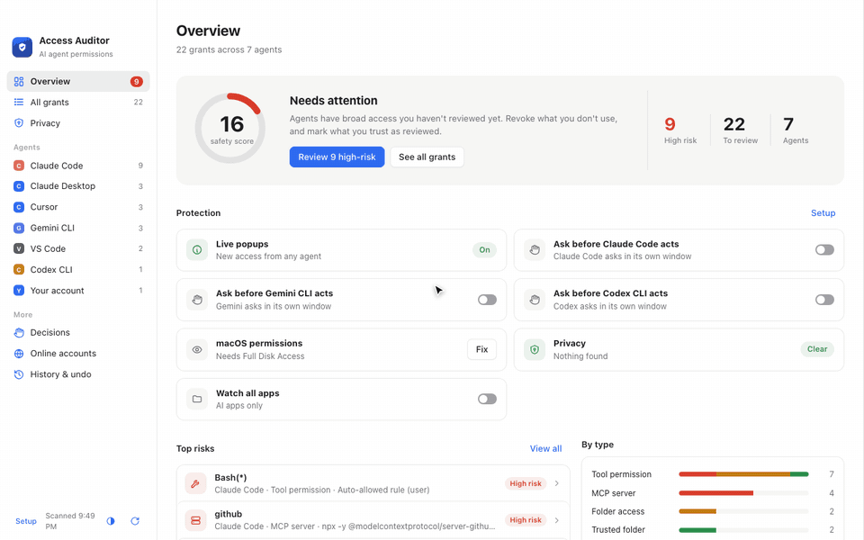
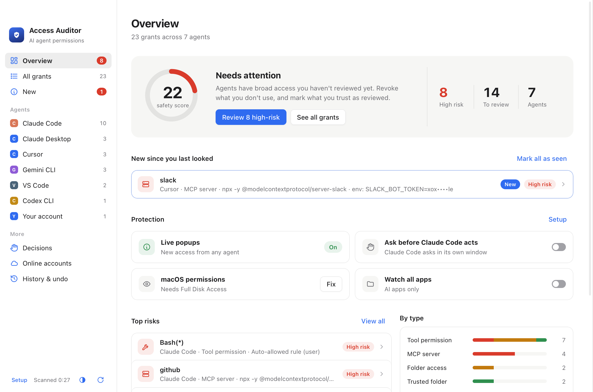
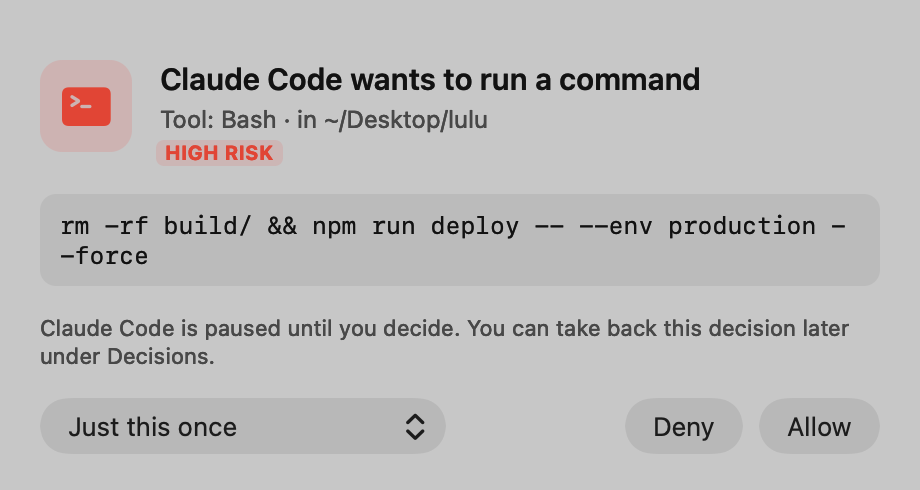
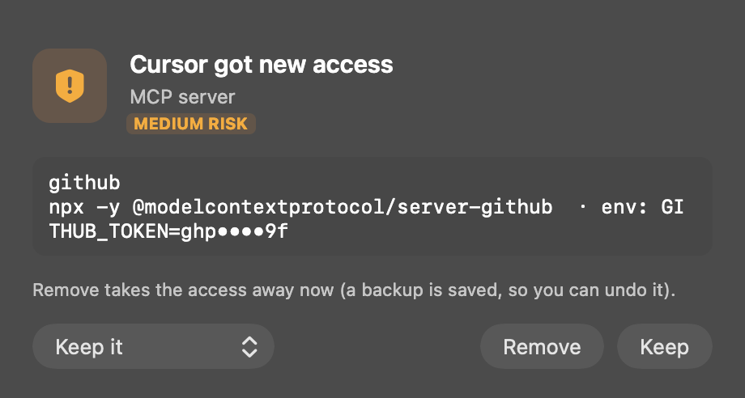

# AI Access Auditor

**See everything your AI coding agents can access on your computer, and take any of it back.**

Claude Code, Codex, Gemini CLI, Cursor, OpenCode and other agents collect permissions over time: auto-approved
commands, MCP servers with tokens, trusted folders, saved logins, API keys left in their logs. AI Access Auditor
finds all of it, explains each item in one line, and lets you remove it with one click, with undo.

Demo with invented data: revoke a risky permission, then undo it from History.

## Install

**[Download from the website](https://dirmedmr-alt.github.io/ai-access-auditor/)** (free), or from the
[latest release](https://github.com/dirmedmr-alt/ai-access-auditor/releases/latest).

| | |
|---|---|
| **Mac** | macOS 13 or later, Apple Silicon and Intel. Signed and notarized by Apple. Or with Homebrew: `brew tap dirmedmr-alt/tap && brew trust dirmedmr-alt/tap && brew install --cask ai-access-auditor` |
| **Windows** | Windows 10 and 11, x64 and ARM installers. Not signed yet, so SmartScreen may warn once: More info → Run anyway. |
| **Linux** | `.deb` for Ubuntu and Debian (x64 and arm64): `sudo apt install ./AI-Access-Auditor-*.deb`. AppImage for other x64 distributions (needs `libfuse2t64` on Ubuntu 22.04+, `libfuse2` on 22.04). |

## What it does

- **Finds every grant:** tool and command permissions, MCP servers, trusted folders, hooks, saved logins,
  API keys in your shell and environment, startup entries, and secrets left in agents' session logs (shown masked).
- **Explains and scores them:** a safety score, and a one-line explanation of each risk.
- **Takes access back:** revoke one grant or many at once, now or after a time limit. Every change is backed up first and can be undone.
- **Watches for changes:** a popup the moment an agent gains new access. Keep it, keep it for a while, or remove it.
- **Asks before agents act:** an optional popup before Claude Code, Codex or Gemini CLI runs a tool, through their own hook systems.

<picture>
  <source media="(prefers-color-scheme: dark)" srcset="site/assets/overview-dark.png">
  
</picture>

  
  

## Privacy

Everything stays on your computer: no account, no telemetry. The only network request is a daily check for a
new version on GitHub, which you can turn off in Setup. The local server listens only on 127.0.0.1, checks a
per-session token, and masks secrets in its output.

## Full details

On Linux the app lives in the tray instead of the menu bar. It finds the same agent access, and in place of
the Mac-only parts it checks systemd and autostart jobs, logins saved in GNOME Keyring or KWallet (by name only),
and membership of the `docker` group. On Windows it checks startup entries (registry and Startup folder),
scheduled tasks, logins in Credential Manager, API keys in the user environment, and admin rights without a UAC
prompt. Uploads aren't watched on Windows.

### What it scans

- **Claude Code:** tool permissions, permission modes, trusted folders, MCP servers and hooks
- **Claude Desktop:** folder grants, browser control, scheduled tasks and permission bypass
- **MCP servers** in Cursor, VS Code, Windsurf, Gemini CLI, Zed, Codex, Cline and Roo Code
- **macOS privacy grants** for AI apps and terminals (this needs Full Disk Access)
- **Saved logins** for AI tools and GitHub in your Keychain (names only, never the secrets)
- **Background agents:** LaunchAgents and LaunchDaemons, plus crontab lines that start AI tools
- **AI extensions** in VS Code, Cursor and Windsurf, and in Chrome, Brave, Edge and Arc
- **Local AI servers** (Ollama, LM Studio) that other devices on your network can reach
- **Other agents' permissions:**
  - Codex: approval policy, sandbox and trusted projects
  - Gemini CLI: auto-accept, allowed tools and trusted folders
  - Cursor CLI: allow rules
  - Copilot CLI: trusted folders, allow-all mode, allowed URLs, and the "always allow" answers it saved per project
  - Windsurf: Cascade's command allow list
  - Kiro: trusted commands, and the allow rules in `permissions.yaml` (Kiro 1.0)
  - Zed: its agent's tool permissions, and the older "always allow" switch
  - Continue: tools its CLI (`cn`) may use without asking, and MCP servers in `config.yaml`
  - Cline: the CLI's auto-approve settings, and MCP tools set to run without asking (Cline, Roo Code)
  - VS Code, Cursor and Windsurf: Copilot auto-approve settings
  - OpenCode: permissions
  - Aider and Goose: auto modes
  - MCP servers in Copilot CLI, Amazon Q, Kiro, OpenCode, Continue, Cline CLI and Claude Desktop extensions
- **Agents running right now** with approvals off (`--dangerously-skip-permissions`, `--yolo`, `--full-auto`, `-y`, and so on) or as root. These can be stopped from the popup
- **Secrets in agents' session history:** keys, tokens and private keys left in the session logs agents keep on disk (only masked previews are shown), with one click to remove them from the log
- **Data sharing:** agents' usage statistics and telemetry, sessions shared publicly, and editors' usage data, with one click to turn each off; plus links to each AI service's training settings
- **Privileges every agent inherits from you:** passwordless sudo, loaded SSH keys, and GitHub, AWS, gcloud, Azure, Kubernetes, Docker and npm logins
- **API keys** exported in your shell startup files
- **Optional "watch all apps":** macOS privacy permissions and background jobs for every app, not just AI apps

### Menu bar and alerts

The Mac app stays in the menu bar after you close its window. Every 5 minutes
it checks for new access. When an agent gains something new, the shield turns red, a notification shows
what was added, and the grant is labeled "New" in the app. "Open at Login" in the shield menu starts it
quietly when you log in. Grants that exist on the first run become your starting list, so you're only
alerted about changes after that.

### Live protection

- **New access pops up right away.** The app watches the agents' config files. When anything gains access, a floating window asks whether to **Keep** it (forever, or for 1 hour, 1 day or 7 days) or **Remove** it.
- **Ask before agents act** (switches on the Overview; one hook script, `gate.js`, for all three):
  - **Claude Code:** a `PermissionRequest` hook in `~/.claude/settings.json`. The popup replaces Claude Code's prompt; Allow can be "just this once" or "always".
  - **Codex CLI:** `PermissionRequest` and `PreToolUse` hooks in `~/.codex/hooks.json`. The popup replaces Codex's prompt, and also steps in when Codex runs without asking (bypass / full-auto). Codex asks you to trust new hooks once (`/hooks`).
  - **Gemini CLI:** a `BeforeTool` hook in `~/.gemini/settings.json`. Gemini's own prompt can't be skipped, so the popup only appears when Gemini wouldn't ask (YOLO, or edits in auto-edit mode).
  - If the app isn't running, each agent works as usual. Every answer is listed under Decisions.
- **New AI agents:** when Claude Code, Codex, Gemini or another agent or AI app appears on the Mac, a popup offers to turn on Allow / Deny for it.
- **AI tools being installed:** `npx … setup`, `npm install -g`, `brew install`, `pipx`, `uv tool install` and `… mcp add` of MCP servers, skills or agent packages, with who started it and what it's connecting to.
- **Data leaving the Mac:** per-process upload counters (`nettop`, every 2 s). Programs an AI agent started are flagged from 64 KB to one address, other apps from 20 MB, with the sensitive files they have open. Stop it, allow it once, or always for that app.
- **Agent skills, sign-ins and "always allow" rules:** skills in every agent's skills folder; logins saved as plain text (`~/.codex/auth.json`, `~/.gemini/oauth_creds.json`) or in the Keychain; Gemini's saved policy rules. All revocable, with a backup.
- macOS privacy prompts (Screen Recording, Accessibility and so on) come from the system itself, so the app can only report them afterwards.

### Actions

- **Revoke:** backs up the file first. You can also tick several grants and revoke them together.
- **Revoke automatically:** after 1 hour, 1 day, 7 days or 30 days.
- **Mark as reviewed:** for grants you want to keep.
- **Restore:** on the History tab.

Every action is logged in `~/.ai-access-audit/`.

## Build it yourself

`./build-app.sh`, then open `dist/AI Access Auditor.app`, or `./build-app.sh --install` to put it in
/Applications. It needs Node.js (`brew install node`) and doesn't use a browser. The Linux and Windows app is
in `desktop/` (Electron); see `build-linux.sh` and `appveyor.yml`.

    npm start        # browser version: http://localhost:4517
    npm run scan     # print the findings in the terminal

## Releasing a download and the website

    VERSION=1.0.8 ./build-linux.sh                                           # Linux files, built in Docker

    VERSION=1.0.8 ./release.sh                                               # local preview in site/downloads
    SIGN_ID="Developer ID Application: <Name> (<TEAM>)" \
      VERSION=1.0.8 REPO=dirmedmr-alt/ai-access-auditor PUBLISH=1 ./release.sh   # sign, notarize, upload

This builds `dist/AI-Access-Auditor-<version>.dmg`:
- It runs on Apple Silicon and Intel, on macOS 13 or later.
- It includes the official Node.js, checksum-verified, so users don't need to install anything.

It also updates the download links, version, size and SHA-256 shown in `site/index.html`. With `REPO`
set, the links point at the GitHub Release, and `PUBLISH=1` uploads the DMG there, together with the Linux files
from `build-linux.sh` (AppImage for x64, `.deb` for x64 and arm64, and `SHA256SUMS-linux.txt`). The Windows
installers are built and tested by AppVeyor (`appveyor.yml`) on every push to `main`; `release.sh` downloads
the ones built for the released commit (`fetch-windows.sh`), so push first and wait for that build to pass.
The GitHub workflows in `.github/workflows/` can build and test Linux and Windows too, when Actions are
available on the account. The website itself
is published from `site/` to GitHub Pages with `./publish-site.sh` (it pushes `site/` to the
`gh-pages` branch, which Pages serves).

A version without `-beta` must be signed: `release.sh` refuses to publish it otherwise. With `SIGN_ID`
it signs the app and the bundled Node.js with the hardened runtime (`macos/node.entitlements` lets Node
compile JavaScript), sends the DMG to Apple's notary service, and staples the result. It needs, once, the
Developer ID Application certificate in the keychain and the notary login saved with
`xcrun notarytool store-credentials ai-access-auditor --apple-id <id> --team-id <team> --password <app-specific password>`.
Betas (`-beta` versions) are signed ad-hoc, published as pre-releases, and users approve them once under
System Settings → Privacy & Security → Open Anyway. The Windows installers aren't signed yet.

Website screenshots come from invented demo data (`AUDIT_DEMO=1`), never from a real Mac.
